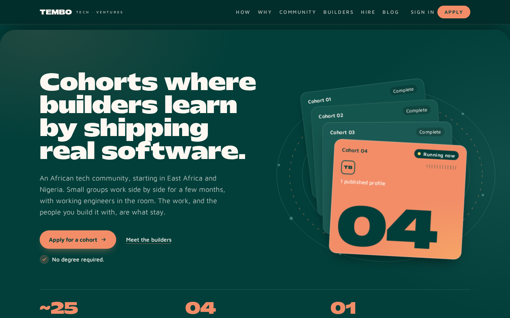
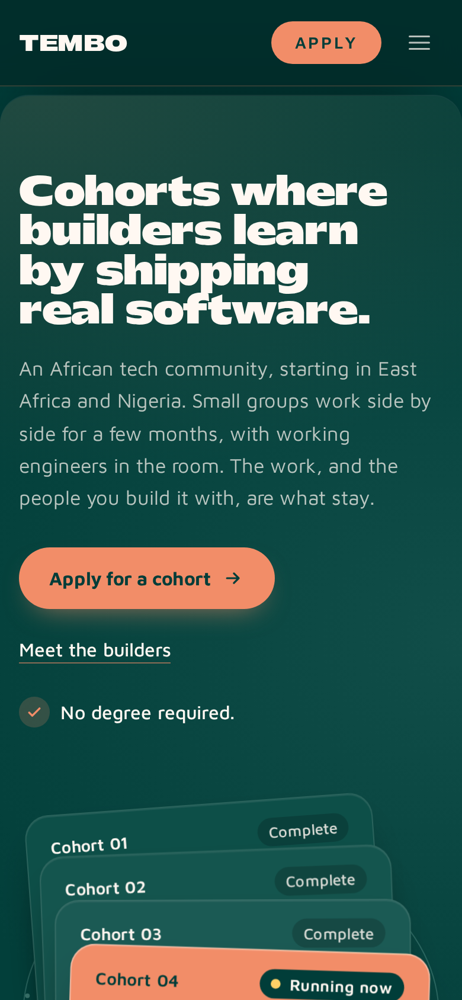
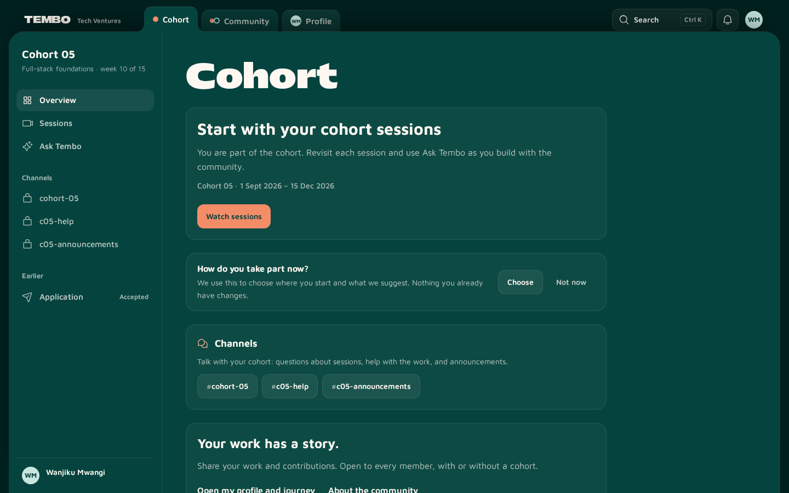
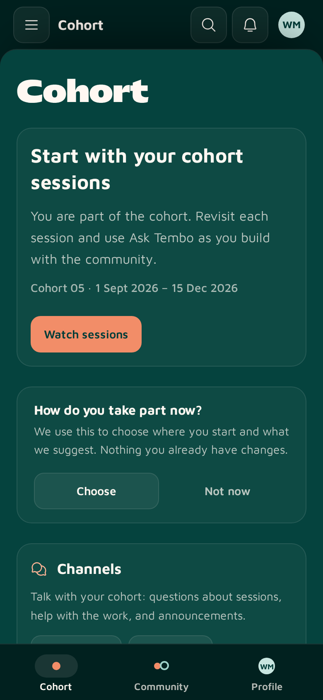
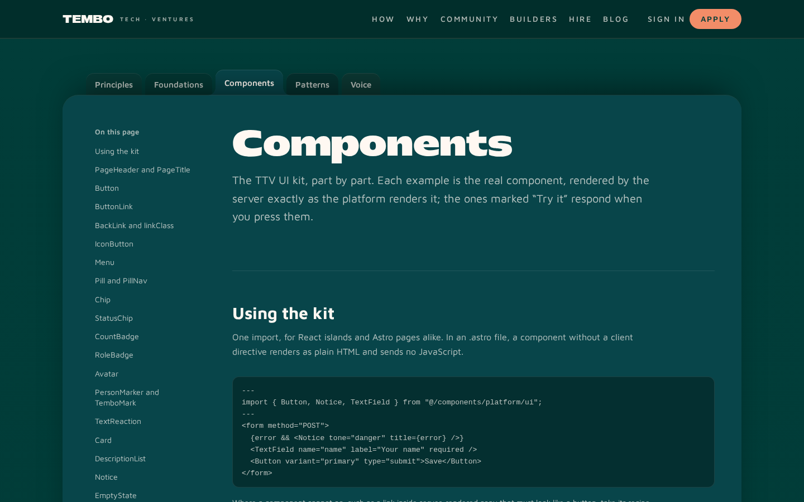

# Tembo Tech Ventures

The website and learning platform for [Tembo Tech Ventures](https://tembotechventures.com) (TTV), an
African tech community starting in East Africa and Nigeria. Small cohorts of early builders learn by
shipping real software alongside working engineers, and a wider community of builders, mentors and
partner institutions grows around them.

This repository holds the whole product: the public site, the signed-in platform for students,
alumni, mentors and institutions, and the admin tools the team runs it with. It is a single Astro
application served by Cloudflare Workers.

<p>
  
  
</p>
<p>
  
  
</p>

The screenshots come from a local build seeded only with fictional people (see
[Screenshots](#screenshots)).

## Contents

- [What it does](#what-it-does)
- [Tech stack](#tech-stack)
- [Getting started](#getting-started)
- [Commands](#commands)
- [Testing](#testing)
- [Project layout](#project-layout)
- [Deployment](#deployment)
- [Documentation](#documentation)
- [Contributing](#contributing)
- [Screenshots](#screenshots)
- [Licence](#licence)

## What it does

**Public site**

- The homepage: cohorts, the skills map, previous builders, the community and how to hire.
- Community pages for members, mentors and institutions (`/community`), and a directory of cohort
  graduates with public builder profiles (`/talent`).
- `/hire`, where organisations share a project and connect with TTV builders.
- The blog, written by students and alumni in the platform's own editor.
- Certificates that anyone can verify at `/certificate/<id>`.
- The style guide (`/style-guide`), which renders the real UI kit.

**Signed-in platform** (GitHub sign-in)

- Spaces for each way a person takes part: Cohort, Community, Mentoring, Discover, Profile and Admin.
  Each person sees only the spaces their roles give them.
- Programme applications and their status, from first application to completed cohort.
- Recorded cohort sessions with transcripts, and **Ask Tembo**, an assistant that answers from the
  sessions of your own cohorts.
- Cohort and community channels, direct messages, mentions and a moderation queue.
- Mentor requests, with each mentor's areas, formats and monthly availability.
- A public profile and portfolio, where mentors can confirm the work a member shows.
- Institutional discovery of members who have saved a community profile.
- In-app feedback from students, which the team groups into themes and answers.

Newer platform features ship behind feature flags that admins set per audience (off, staff or
everyone) at `/admin/platform-flags`. See
[platform spaces and channels](web/docs/platform-spaces-and-channels.md).

## Tech stack

| Layer | Technology |
| --- | --- |
| Framework | [Astro 7](https://astro.build) (server-rendered) with React 18 islands |
| Language | TypeScript 5 |
| Styling | Tailwind CSS 4 and the TTV UI kit (`web/src/components/platform/ui`) |
| Runtime | Cloudflare Workers |
| Data | Cloudflare D1 (SQLite) through Drizzle ORM, R2 for files, Vectorize for transcript search |
| AI | Workers AI through AI Gateway |
| Media | Cloudflare Queues and an FFmpeg Cloudflare Container for session recordings |
| Auth | [Better Auth](https://better-auth.com) with GitHub OAuth |
| Tests | Vitest and Playwright |

[ARCHITECTURE.md](ARCHITECTURE.md) has the routes, the data model and the conventions in full.

## Getting started

You need Node.js 22 and npm. Every npm command runs from `web/`.

```sh
git clone https://github.com/tembo-tech-ventures/ttv-website.git
cd ttv-website/web
npm ci --legacy-peer-deps
npm run db:migrate:local
CLOUDFLARE_VITE_FORCE_LOCAL=true npm run dev
```

The site is then at <http://localhost:4321>. The dev server runs in the background: `npx astro dev
logs` shows its output and `npx astro dev stop` stops it.

- **Local Cloudflare.** Wrangler emulates D1 and R2 on your machine; the database lives in
  `web/.wrangler/`. `CLOUDFLARE_VITE_FORCE_LOCAL=true` keeps every binding local. Workers AI and
  Vectorize have no local emulation, so Ask Tembo and Discover's ranked search fail in that mode.
  Without the variable, the dev server reaches those bindings in your Cloudflare account and needs
  `npx wrangler login`.
- **Configuration.** `web/.env` holds development-only defaults and is committed, so never put a
  real secret in it. Put local secrets in `web/.dev.vars`, which git ignores. When `.dev.vars` exists
  Wrangler reads it instead of `.env`, so copy across the values you still need.
- **Signing in.** Sign-in is GitHub-only. To sign in locally, create a
  [GitHub OAuth app](https://github.com/settings/developers) with the callback URL
  `http://localhost:4321/api/auth/callback/github` and set `GITHUB_CLIENT_ID` and
  `GITHUB_CLIENT_SECRET`.
- **Fictional data.** `web/e2e/platform-personas.local.sql` seeds fictional students, an alumna, a
  mentor, an institution user and an admin into the local database, for browser tests and
  screenshots. Apply it only to a local database:
  `npx wrangler d1 execute ttv-database --local --file e2e/platform-personas.local.sql`.
- **Feature flags.** Locally, `PLATFORM_FLAGS_OVERRIDE=all` in `.dev.vars` turns every flag on.
  Production ignores it.

## Commands

| Command | What it does |
| --- | --- |
| `npm run dev` | Start the Astro dev server on port 4321 |
| `npm run build` | Build the Worker for production |
| `npm run preview` | Serve the production build locally |
| `npm test` | Unit tests, then `.astro` render tests (Vitest) |
| `npm run test:watch` | Vitest in watch mode |
| `npm run test:e2e` | Playwright against a deployed preview (CI runs this) |
| `npm run test:e2e:list` | List the Playwright tests without running them |
| `npm run lint` | Oxlint, then ESLint |
| `npm run lint:fix` | Apply the automatic lint fixes |
| `npm run typecheck` | `tsc --noEmit` |
| `npm run typecheck:astro` | `astro check` |
| `npm run knip` | Find unused files and dependencies |
| `npm run audit:ci` | The dependency audit CI runs |
| `npm run db:generate` | Generate a Drizzle migration from schema changes |
| `npm run db:migrate:local` | Apply the migrations to the local D1 |

The `cf:*` scripts provision, deploy, smoke-test and tear down Cloudflare environments. They are
meant for the GitHub workflows and for isolated agent previews, not for staging or production by
hand (see [Deployment](#deployment)).

## Testing

```sh
cd web
npm test
npm run lint
npm run typecheck
```

- **Unit and render tests** sit next to the code they test (`*.test.ts`, `*.render.test.ts`) and in
  `web/scripts/*.test.mjs`. Database tests use an in-memory SQLite stand-in for D1
  (`web/src/test/sqlite-d1.ts`), so no Cloudflare account is needed.
- **Browser tests** live in `web/e2e/`, run in Chromium at desktop and mobile sizes, and include axe
  accessibility checks. To run one against your dev server:
  `npx playwright install chromium`, then `npx playwright test e2e/homepage.spec.ts`. Signed-in
  specs need the fictional seed above; see `web/src/components/platform/spaces/README.md`.
- **This README** is tested too: `web/scripts/readme.test.mjs` checks that its links, images and
  documented commands exist, and that every screenshot matches its capture settings.

CI runs lint, typecheck, knip, the unit tests, the dependency audit and a check that every
Playwright test still loads. Each pull request also deploys an isolated preview and runs the
Playwright suites against it (see [Deployment](#deployment)).

## Project layout

```text
ttv-website/
├── web/                     The Astro application
│   ├── src/
│   │   ├── pages/           Routes and API endpoints (file-based)
│   │   ├── layouts/         Page shells: public, spaces, admin, certificate
│   │   ├── components/      Astro and React components; platform/ui is the UI kit
│   │   ├── lib/             Domain logic: auth, platform, channels, tembo, recordings, …
│   │   │   └── db/          Drizzle schema and D1 migrations
│   │   ├── middleware.ts    Sessions and route guards
│   │   └── styles/          Tailwind theme and design tokens
│   ├── e2e/                 Playwright specs
│   ├── scripts/             Cloudflare deployment and maintenance scripts
│   ├── containers/          The FFmpeg container
│   └── docs/                Feature and design-system documentation
├── docs/                    Operations, delivery and runbooks
└── .github/workflows/       CI, previews, staging and production
```

## Deployment

- **Production.** Merging to `main` deploys <https://tembotechventures.com> through the
  `Cloudflare Production` workflow. The pipeline checks that `/api/health` reports the new commit,
  runs smoke and Playwright checks, and rolls the Worker back if they fail.
- **Pull requests.** Each pull request gets an isolated Cloudflare preview with its own D1, R2 and
  Worker, and the Playwright suites run against it. Closing the PR tears the preview down.
- **Staging.** <https://staging.tembotechventures.com> is deployed from GitHub Actions.

Merging is the only way code reaches production. Never run `wrangler` or the `cf:*` scripts against
staging or production. [docs/operations.md](docs/operations.md) has the full rules, and
[web/docs/cloudflare-environments.md](web/docs/cloudflare-environments.md) the environments, secrets
and token scopes.

## Documentation

| Topic | Where |
| --- | --- |
| Architecture, routes and data model | [ARCHITECTURE.md](ARCHITECTURE.md) |
| Operations, monitoring and the production policy | [docs/operations.md](docs/operations.md) |
| Preview and production delivery for agents | [docs/agent-delivery-map.md](docs/agent-delivery-map.md) |
| Cloudflare environments | [web/docs/cloudflare-environments.md](web/docs/cloudflare-environments.md) |
| Lint and quality gates | [docs/code-quality.md](docs/code-quality.md) |
| Design system: principles, tokens, components, voice | [web/docs/design-system/](web/docs/design-system/README.md) |
| The homepage | [web/docs/homepage.md](web/docs/homepage.md) |
| Spaces, channels and feature flags | [web/docs/platform-spaces-and-channels.md](web/docs/platform-spaces-and-channels.md) |
| Session recording imports | [docs/session-recording-imports.md](docs/session-recording-imports.md) |
| Student feedback | [web/docs/student-feedback.md](web/docs/student-feedback.md) |
| Blogging | [web/docs/blogging.md](web/docs/blogging.md) |
| Navigation performance | [web/docs/performance.md](web/docs/performance.md) |

Many feature folders also have their own README, for example
[channels](web/src/lib/channels/README.md), [Tembo](web/src/lib/tembo/README.md) and
[mentoring](web/src/lib/mentoring/README.md).

## Contributing

1. Branch from `main`; never commit to it directly.
2. Build UI from the UI kit (`@/components/platform/ui`) and follow the
   [design system](web/docs/design-system/README.md). The public style guide at `/style-guide`
   renders every kit component live.
3. Add an automated test with every behaviour change, in the same commit.
4. Run `npm test`, `npm run lint` and `npm run typecheck` in `web/` before you push. New lint
   warnings aren't accepted.
5. Open a pull request using the [template](.github/pull_request_template.md). It merges once CI
   and its preview deploy are green.

AI agents working in this repository start with [AGENTS.md](AGENTS.md) and [CLAUDE.md](CLAUDE.md).



## Screenshots

The images in this README are real pages from a local production build of `main`, taken with
`web/scripts/readme-shots.mjs`. Its database held only the fictional people in
`web/e2e/platform-personas.local.sql`, never staging or production data. The script's header
describes how to retake them.

## Licence

The repository has no licence file, so the code isn't licensed for reuse. The self-hosted fonts
are under the SIL Open Font License 1.1 (`web/src/assets/fonts/`).
