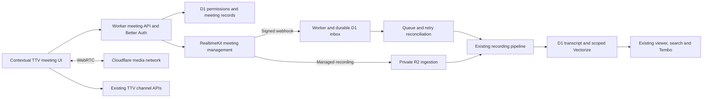

# In-app video conferencing: implementation proposal

Research date: 2026-11-04. Repository baseline: `bb3d97d6c5a3e31d0de9e1b48a16a838f025a361`.
Status: proposed architecture, not a shipped feature. This document changes no runtime behavior.

Use **Cloudflare RealtimeKit's React SDK and UI components**, with TTV owning
meeting authorization, persistent chat, recording organization, and search.
Keep recordings in private R2 and extend the existing processing/viewer pipeline.
Start with cohort teaching sessions; use the same meeting primitive for private
mentor calls and community events after the recording access layer is generalized.

The difficult work is not rendering a video grid. It is keeping meeting access,
chat access, recording publication, retries, and search consistent across contexts.

## What is already here

| Existing implementation | Reuse and required change |
| --- | --- |
| `web/package.json`: Astro 7.3.2, React 18, Cloudflare adapter | The repository has advanced beyond the guide's Astro 6 description. Load the meeting SDK only in a browser React island; validate bundling and browser lifecycle in the spike. |
| `web/src/components/platform/spaces/{SpacePage.astro,sidebar.ts}` | Preserve contextual navigation. A meeting is an activity within a space, not another top-level space. |
| `web/src/pages/dashboard/sessions/{index,[id]}.astro` | Today Sessions is a reverse-date grid of cohort recordings, with processing badges. Add upcoming/live sessions above the recording list, retaining existing links and access. Space routes map this to `/dashboard/cohort/sessions`. |
| `web/src/components/recordings/{SessionViewer,TranscriptPanel}.tsx` | Already provides video, transcript search, active segment highlighting, timestamp seeking, and recovery from playback errors. Reuse for every recording context. |
| `web/src/pages/api/recordings/[id]/video.ts` | Private R2 streaming with byte ranges. Keep range playback and enforce the new shared recording policy here. |
| `web/src/lib/recordings/{pipeline,transcription,embeddings}.ts` | Queue → FFmpeg audio extraction/chunking → speech transcription → D1 segments/VTT → Vectorize. Add a RealtimeKit ingestion source, not a second processing pipeline. |
| `web/containers/ffmpeg/server.js` | Extracts 64 kbps mono MP3 and transcription chunks. Returns the original video key unchanged: **video is not currently compressed**. |
| `web/src/lib/search/README.md` and `web/src/lib/chat/tools.ts` | Platform search is authorized SQL substring search. Tembo also has semantic transcript retrieval. Both need explicit context-aware recording scopes. |
| `web/src/lib/channels` and `web/src/components/channels` | Persistent threads, moderation/masking, read state, search, and mentor direct conversations exist. Open channels poll every five seconds. Reuse their server rules inside meetings. |
| `web/src/lib/attention/producers.ts` | Existing recording-ready notification can be extended to the actual recording audience. Do not notify a whole cohort about a private call. |

The UX assessment above is from source and existing design documentation, not a
new authenticated desktop/mobile browser audit. A live meeting prototype still
needs real-device review; no conferencing quality or accessibility is claimed yet.

## Framework choice

| Option | Assessment |
| --- | --- |
| **RealtimeKit Core + React UI Kit** | Recommended. Cloudflare manages signaling/media and provides meeting lifecycle, participant management and composable UI. Use `@cloudflare/realtimekit-react` and `@cloudflare/realtimekit-react-ui`; pin validated versions. See [UI Kit](https://developers.cloudflare.com/realtime/realtimekit/humans/ui-kit/). |
| RealtimeKit Core with entirely custom controls | Same managed service, greater UI ownership. Use selected UI components first and replace them where TTV's workflows require it. A full rewrite adds browser/media-state work unnecessarily. |
| Realtime SFU + Workers/Durable Objects | Lower-level media routing; we own rooms, signaling policy, track lifecycle and the recording solution. Cloudflare itself directs conferencing users toward RealtimeKit. See [SFU overview](https://developers.cloudflare.com/realtime/sfu/). |
| Cloudflare Meet, formerly Orange Meets | Useful open-source reference for the lower-level approach, not a drop-in TTV meetings framework. A fork would make us maintain a second app's meeting architecture. See [repository](https://github.com/cloudflare/meet). |
| Cloudflare Stream | A playback/live-broadcast product, not the interactive meeting layer. Consider later for managed adaptive playback if measured viewing volume and network problems justify the cost. See [Realtime product guidance](https://developers.cloudflare.com/realtime/). |

Registry check on this date: `realtimekit-react` 2.0.4 declares React >=16.8.6,
compatible with the current React 18 dependency; `realtimekit-react-ui` is 2.0.3
and reports no peer dependency field. This is manifest evidence only, not a tested
Astro integration. No packages were added.

RealtimeKit exposes screen sharing, waiting rooms, host controls, polls, breakout
rooms and plugins through its SDKs. Treat feature availability as separate from
TTV readiness: each exposed control needs permissions, accessible states and
real-browser tests. Start from the [SDK index](https://developers.cloudflare.com/realtime/llms.txt).
A whiteboard can use the hosted plugin later; it introduces its own retention and
sharing questions. Do not promise dial-in telephony, remote desktop control or
end-to-end encrypted recording as part of this design.

## Product experience

**Cohort:** an instructor schedules a session from Sessions, sets its title,
start time, host(s), and recording audience. The cohort channel receives a meeting
card. Members can open a device check before joining. The same card becomes
“Watch recording” after processing; the recording retains the title/date/cohort
without an admin importing it or guessing from a filename.

**Mentoring:** an accepted request already opens a two-person DIRECT conversation.
Either member can propose a call there. Recording is off by default; an explicit
recording choice explains that it is private to the two people. Global mentor or
admin status must not silently grant access to the recording. Avoid recording
private calls automatically merely because the cohort uses automatic recording.

**Community:** a channel moderator can schedule a discussion tied to that channel.
The join page clearly states whether the audience is the channel or explicit
invitees, and who will later see the recording. Joining and publishing are distinct
permissions. Defer unrestricted creation of paid meetings to every signed-in user
until per-user quotas and abuse controls exist.

**Meeting surface:** a dedicated `/dashboard/meetings/:id` route contains the same
reusable `MeetingRoom` island regardless of entry point. Keep a small context link,
meeting title, readable audience label, persistent recording status and one clear
Leave action. Hosts also get End for everyone, with a separate confirmation.
Use the established TTV type, teal/warm-white surfaces and peach actions around a
quiet media stage. Do not animate video tiles decoratively.

Desktop has the screen share/speaker stage and one optional side panel for chat
or people. Mobile gives the stage the full width, a stable bottom control bar and
one panel at a time. Prioritize listening, mute and reconnect over a dense grid.
Hide unsupported sharing controls with an explanation; receiving a shared screen
does not mean the phone browser can publish one. Verify browser screen capture
support before offering it. The native iOS SDK needs additional setup, so it is
not evidence of mobile-web parity ([screen-sharing guidance](https://developers.cloudflare.com/realtime/realtimekit/humans/core/ios-screen-sharing/)).

Prejoin must handle denied/missing devices, microphone test, camera-off join,
waiting for host and a low-data option. In-call states include reconnecting,
device removal, share cancellation, host departure and recording start failure.
Announce recording transitions to everyone, including late joiners. Show
“Starting recording” until the provider confirms it is recording. Permission to
record and participant acknowledgement must be server-owned; settle the exact
consent/retention wording before public rollout.

Initially open calls in a dedicated tab or use an explicit leave-before-navigation
flow. Astro navigation can unmount an island and disconnect media. A persistent
mini-call across every space is a later shell-level feature, not a consequence of
embedding a React component. Always release device tracks and SDK subscriptions
on leave/unmount, including failed initialization.

## Shared architecture and contracts

The Worker is the control plane; never proxy live audio/video through Astro.
A new Durable Object is not required just to create rooms: RealtimeKit already
handles meeting signaling. Add one only for a demonstrated coordination need.

Proposed module boundaries:

- `lib/meetings/contracts.ts`: Zod requests, responses and state enums.
- `lib/meetings/access.ts`: create/join/host/record/publication policies.
- `lib/meetings/provider.ts`: narrow RealtimeKit adapter, injectable HTTP client.
- `lib/meetings/service.ts`: idempotent meeting/participant commands.
- `lib/meetings/webhooks.ts` and `recording-ingest.ts`: verified provider events.
- `components/meetings/MeetingRoom.tsx`: SDK lifecycle and composed UI.
- `lib/recordings/access.ts`: authoritative recording reads across all surfaces.

Suggested API: `POST /api/meetings`, `GET /api/meetings/:id`,
`POST /api/meetings/:id/join`, `/end`, `/recordings/start`, `/recordings/stop`,
and `POST /api/webhooks/realtimekit`. Browser mutations reuse existing origin,
session, flag and conduct gates. Webhooks use their own signature authentication;
exempt only that exact route from browser-session requirements. Reject arbitrary
provider IDs, presets, storage configs and roles supplied by clients.

Join checks current TTV permissions and capacity, then adds a provider participant
with a server-selected preset and TTV user mapping. Return its token with
`Cache-Control: no-store`; never put it in URLs, storage, analytics or logs. Verify
provider token lifetime/rejoin/removal behavior in the spike rather than assuming
it supports our preferred expiry. Revocation must remove connected participants
and prevent rejoining with a previously minted token, not merely hide the button.

Separate capabilities: `canJoin`, `canPublishAudioVideo`, `canShareScreen`,
`canManageParticipants`, `canStartRecording`, `canPublishRecording`. Global roles
alone are insufficient. Prefer server-only recording start/stop with provider
preset permissions that prevent a participant bypassing TTV's recording controls.
Test whether required SDK host controls can be enabled independently.

## Data model and access migration

Use TTV IDs as primary identifiers and store provider IDs separately. Proposed
migration (schema, SQL and Drizzle metadata together):

| Entity | Essential fields/invariants |
| --- | --- |
| `meeting` | title, creator, scheduled times, lifecycle, context kind, nullable program/channel references, provider app/meeting ID, recording policy; CHECK valid context combinations. One provider room per occurrence initially; recurring series can be separate later. |
| `meeting_member` | meeting/user unique pair, host/member role, invitation/revocation state. An invite never bypasses the containing context's policy. |
| `meeting_run` | meeting and provider session ID, actual start/end; unique provider session mapping. Rejoins and restarts must not overwrite earlier occurrence history. |
| `meeting_recording` | provider app/recording ID unique, run ID, TTV recording ID, upload state and expected object prefix. One run can have multiple recording parts. |
| `provider_event` | verified payload hash/delivery reference, provider resource identity, processing state, retry attempts and timestamps. Store only required fields; avoid tokens/signed URLs in logs. |
| `recording` additions | explicit access scope, origin, nullable meeting-run reference, separate publication and media/transcript readiness. Retain `programId` for cohort compatibility. |
| `recording_asset` | source/playback/audio/captions, R2 key, codec/profile, bytes, duration and validation state. Playback points only at a validated version. |
| `recording_collection` / membership | titles/order/tags for organization; collection membership is not a visibility grant. Introduce after the basic recording workflow if filters suffice initially. |

Backfill existing program recordings to COHORT access, and unassigned imports to
ADMIN_ONLY. New DIRECT recordings explicitly inherit the two-person conversation
policy. Community recordings explicitly inherit a named channel policy. No
missing scope means public. Do not overload `programId = null` with “private”.

**Prerequisite found in the code:** `getRecordingDetails` in `lib/chat/tools.ts`
only denies a non-admin when `rec.programId` is truthy and inaccessible. A null
program therefore skips that denial, whereas `userCanAccessProgram` denies null.
Additionally, semantic search queries global Vectorize top-K before D1 filtering.
These are unsafe foundations for private-call ingestion. Add regression coverage
and unify policy before enabling any new recording scopes. This research did not
probe production or determine whether a real unassigned transcript is exposed.

Use one policy in listing, detail, byte-range playback, captions, downloads,
transcript tools, search, embeds, attention, MCP and Tembo. Preserve existing
cohort exceptions only for legacy cohort/admin workflows; they must not become
an admin override for private mentoring content. Institution discovery gets no
new recording access. A collection move or copied link never broadens access.

Scope semantic retrieval before top-K, using scope metadata and bounded queries
for the caller's authorized scopes; recheck each result against current D1 ACLs
before returning text or sending it to a model. Reindex legacy vectors in a
controlled migration. If an authorized scope set exceeds provider filter limits,
use bounded per-scope fan-out or authorized SQL fallback; do not fall back to a
global search. Test a private relevant result competing with many unauthorized
results, as well as revocation after indexing. Keep cohort Tembo scoped to cohorts;
add private meeting Q&A only with an explicit meeting scope.

Chat should be a meeting panel over the existing channel API, with native provider
chat disabled. A cohort meeting can use a channel thread; a mentor call uses its
DIRECT conversation. Meeting audience and chat audience must match, or the UI must
explicitly show the broader channel audience and never copy private call content
there. Do not add arbitrary group-private meetings before there is a matching
persistent chat/access model. Five-second polling is usable for the first release;
optimistic sends already help. If tighter latency is necessary, add a Durable
Object notification channel that triggers authorized reads, preserving D1 and
moderation as the source of truth. Do not broadcast unmoderated text over provider
chat or data channels and mask it afterwards.

## Reliable recording ingestion

RealtimeKit can write directly to our R2 bucket using its custom storage support
([configuration](https://developers.cloudflare.com/realtime/realtimekit/recording-guide/custom-cloud-storage/)).
Use a dedicated private ingestion bucket with bucket-limited R2 credentials so the
provider cannot overwrite unrelated TTV assets. An extra Worker R2 binding reads
it; canonical validated assets live in the existing recording bucket. Configure
per-environment apps/buckets and deterministic recording-specific prefixes. The
provider's filename documentation is inconsistent about full names versus prefixes;
validate returned names instead of relying on a guessed exact filename.

1. Persist the TTV recording request and idempotency key before calling the provider.
   Serialize start/stop and reconcile ambiguous timeouts; blindly retrying a start
   could create another billable export. Keep multiple simultaneous exports disabled.
2. Verify webhooks against raw bytes using the documented RSA-SHA256 signature and
   trusted public key endpoint. Bind events to this environment's known app, meeting,
   session and recording. Reject mismatched IDs; documentation examples are not a
   substitute for real payload fixtures. Headers alone are not an authorization
   boundary. See [webhook contract](https://developers.cloudflare.com/realtime/realtimekit/webhooks/).
3. Persist a durable event/outbox before acknowledging. Deduplicate by delivery
   reference and resource/state identity; delivery headers are not signed payload
   freshness. Reject malformed/oversized inputs. Out-of-order events cannot regress
   terminal state. Return 5xx on transient persistence failure so delivery retries.
4. On confirmed UPLOADED, verify the expected private R2 object exists and validate
   size/type/media metadata. Queue once through an outbox that can recover from a
   crash between D1 commit and Queue send. Consumers also require idempotent claims.
5. Promote the asset and enqueue existing `process_recording`. Recording upload,
   playable video, and searchable transcript are separate milestones. A failed
   transcript must not erase a valid playable recording.
6. Reconcile stuck exports and pending outbox entries on a bounded schedule. Handle
   missing webhook, expiry, duplicate queue delivery, provider 429/5xx, empty/short
   recordings and lost upload. Use DLQ/admin retry with identifiers and stage errors.

Provider recordings/transcripts have a documented seven-day retention window;
provider storage is not our archive ([retention](https://developers.cloudflare.com/realtime/realtimekit/platform/data-retention/)).
Where possible disable the extra provider-bucket copy after direct R2 ingestion is
verified; explicitly account for retained provider metadata. Any fallback download
must refresh expired URLs through the API, allowlist hosts and redirects, stream
bounded bytes, and never fetch arbitrary webhook URLs. Prefer direct R2.

Keep existing speech transcription initially. It currently uses Workers AI Whisper;
Gemma 4 is the project's text reasoning model, not a speech-to-text replacement.
Route new text summaries/Q&A through the approved AI Gateway/Gemma path. Do not
turn on provider AI summaries or a second transcription bill by default. Evaluate
provider transcripts later for timestamps, speaker attribution, Kenya-accented
speech, code vocabulary, access and model-policy compatibility.

## Smaller files without unreadable code

First measure managed output. Cloudflare quotes approximately 300 MB/hour for its
composite recording, not a guarantee ([recording guide](https://developers.cloudflare.com/realtime/realtimekit/recording-guide/start-recording/)).
It may already be smaller than imported Meet files. The recording codec guide
lists H.264/MP4 and VP8/WebM; do not assume managed AV1, HEVC, arbitrary bitrate or
CRF controls exist ([codec settings](https://developers.cloudflare.com/realtime/realtimekit/recording-guide/configure-codecs/)).

Use H.264/AAC MP4 first for compatibility with the current HTML video viewer.
Record a screen-share-focused composition for teaching: the code is the main
subject, not a small tile inside a gallery. Custom recording layouts must be tested
separately from the participant UI. Avoid chat text in the baked-in video: edits,
masking and deletions cannot then be applied to that text.

If measured output is too large, add an optional playback derivative to the
existing one-shot FFmpeg job. Trial settings, not a guaranteed optimum:

- Talking heads: maximum 720p, H.264 CRF 26, `veryfast`, 24 fps, AAC mono 64 kbps.
- Code/screens: retain up to 1080p where source detail exists, 10–15 fps, CRF 23–26;
  inspect small terminal text and scrolling. Upscaling a 720p composite cannot
  recover readable text that was never captured. Benchmark source layout first.
- MP4 `+faststart`; preserve the complete timeline so transcript links remain valid.
- Offer audio-only playback for low-data review; extend the viewer with an actual
  audio mode rather than pretending an audio file is a video asset.

At a measured *total* average bitrate of 0.6–1.2 Mbps, one hour is approximately
270–540 MB (bitrate × 3,600 ÷ 8). These are arithmetic examples, not predicted
savings. A 300 MB managed source might grow under the proposed encode. Keep the
source when the candidate is larger or quality is worse. Measure bytes/hour,
encoding CPU time, first-play latency, speech intelligibility and code readability
on representative synthetic teaching clips before choosing defaults.

Write a new immutable object, validate decodability/duration/audio/seek behavior,
then atomically switch the asset pointer. Never overwrite the sole source while
encoding. Source retention/deletion needs an explicit policy and a delayed,
recoverable cleanup job; no deletion is authorized by this proposal.

Do not increase `max_instances` or queue `max_concurrency` above 1. Added video
encoding may take much longer than audio extraction and can exceed existing
pipeline timeouts. Benchmark against current Container memory/disk limits and
queue lease/retry behavior first. Every start/health path must call `destroy()`
in `finally`, with regression tests. Prefer managed output over expensive AV1
encoding on this constrained single-container pipeline.

## Cost model

Verified documentation on 2026-11-04 reports these monthly allowances and marginal
rates: 10,000 A/V participant-minutes free, then $0.002/minute; 100 composite
recording minutes free, then $0.010/minute. Audio-only presets have a separate
10,000-minute allowance then $0.0005/minute; turning a camera off does not change
an A/V preset's billing class. See [current pricing](https://developers.cloudflare.com/realtime/realtimekit/platform/pricing/).

For A/V calls with one composite recording, let P be total monthly participant
minutes and R be recorded minutes. Estimate incremental RealtimeKit cost as:

`max(0, P - 10_000) * 0.002 + max(0, R - 100) * 0.010`

| Example month | Participant minutes | Recording minutes | Estimated RealtimeKit |
| --- | ---: | ---: | ---: |
| Four 60-minute sessions, 20 people each | 4,800 | 240 | $1.40 |
| Eight 90-minute sessions, 25 people each | 18,000 | 720 | $22.20 |
| Twenty 60-minute sessions, two people each | 2,400 | 1,200 | $11.00 |

Assumes unused account allowances, full attendance, one export and no other
RealtimeKit traffic. These are incremental conferencing/export estimates, not
whole-platform bills. Add Workers/D1/Queues, storage/operations, transcription,
embeddings, AI Gateway/model usage, Containers and any duplicate exports.
The marketing calculator still carries a beta/free disclaimer while the current
documentation publishes rates; budget using these rates and verify account billing
before launch rather than assuming free beta usage indefinitely.

R2 Standard is $0.015/GB-month beyond its 10 GB free allocation, with separate
operation pricing and no egress fee ([R2 pricing](https://developers.cloudflare.com/r2/pricing/)).
At 300 MB/hour, 100 hours uses roughly 30 GB, or $0.30/month beyond an otherwise
unused 10 GB allowance. Originals, derivatives and audio add to this. Storage is
likely cheaper than participants, managed exports or repeat encoding.

Stream charges storage capacity in 1,000-minute increments at $5/month and
$1/1,000 delivered minutes ([Stream pricing](https://developers.cloudflare.com/stream/pricing/)).
Keeping 100 hours would therefore require $30/month in storage capacity before
viewing. It simplifies adaptive playback but conflicts with the remembered low
budget unless its benefits are needed. Smaller files do not reduce Stream's
minute-based storage bill.

Lower-level SFU/TURN currently shares a 1,000 GB monthly free egress allowance,
then $0.05/GB ([SFU pricing](https://developers.cloudflare.com/realtime/sfu/platform/pricing/)).
That can be cheaper for media, but is not an equivalent price for a complete
conferencing/recording system. Do not select it solely by comparing that rate
with RealtimeKit participant pricing.

Implement application budgets: who may create calls, per-room capacity and
maximum duration, one export at a time, recording `max_seconds`, usage counters,
and alerts before paid thresholds. End meetings explicitly and reconcile stale
provider sessions; a closed browser is not proof that billing stopped. Recording
caps alone do not cap participant minutes. Initial maximum room size and monthly
budget are product decisions; benchmark 2, 10 and 25 participants before claiming
a supported capacity.

## Delivery slices and tests

Estimated engineering effort for one experienced engineer, including tests and
integration review: roughly **4–6 weeks** for a useful cohort-first release and
**another 2–4 weeks** for private/community rollout and broader meeting polish.
These are planning estimates, not a fixed quote. Account provisioning and real
mobile/network failures are the largest schedule uncertainties.

| Slice | Concrete result | Required automated coverage and live gate |
| --- | --- | --- |
| 0. Provider spike, 2–3 days | Isolated RealtimeKit app; two real browsers join; screen share; managed R2 recording; exact SDK compatibility and real webhook fixtures captured safely | Adapter contract tests; live join/rejoin/host removal/token reuse test; actual R2 export and playback. Check recording layouts, provider account activation and preset controls. |
| 1. Permissions/data, 3–5 days | Shared recording policy; meeting/run/member tables; feature flag OFF; regression-safe legacy backfill | Migration-backed SQLite/D1 tests; APPROVED/AUDIT/COMPLETED and assigned staff role matrix; deny cross-cohort, null-scope, revoked users and nonmember admin on DIRECT media; every read/tool path. |
| 2. Cohort meeting UI/API, 4–7 days | Schedule/start/join/prejoin, mic/camera/devices, screen share, people, waiting room, host end/remove, contextual chat | Route auth/origin/conduct/flag tests; forged preset/ID denial; timeout/429/create race; SDK init/leave cleanup; keyboard/mobile layout and status announcements. |
| 3. Recording integration, 4–6 days | Server-controlled recording, verified webhooks, inbox/outbox, direct R2 ingestion, existing processing and ready notification | Real RSA-signed fixtures and changed raw bytes; replay/duplicate/out-of-order events; cross-app/session denial; crashes around queue publish; absent/truncated objects; expiry/redirect rejection; DLQ retry and exactly one logical recording. |
| 4. Organization/search, 3–5 days | Cohort auto-filing, filters/tags, reusable viewer, published visibility and media/transcript readiness split | Access across list/detail/range/captions/transcript/search/embed/attention/MCP/Tembo; scope-limited vector calls; stale index and revoked link tests; no private text in model payloads. |
| 5. General-purpose rollout, 5–10 days | DIRECT mentoring and community contexts, audience labels, consent, low-data behavior, private library | Two-party privacy matrix including admins/institutions; mismatched chat/meeting audiences; recording starts with late join; public-channel sharing cannot widen private recording scope. |
| 6. Compression and extended features, measured separately | Optional smaller derivative, audio mode; then polls, reactions, breakout rooms/whiteboard as needed | Real synthetic media probe/encode/playback fixture; duration/seek/text legibility; larger output fallback; failure leaves source intact; container destroy on success/failure/timeout. Breakout room ACL/chat/recording tests before enabling. |

Required browser matrix: desktop Chromium/Firefox/Safari; Android Chrome and iOS
Safari on actual devices for media. Playwright at 1440 px and 390 px covers the
surrounding UI and fake media state; it does not prove real screen-capture,
Bluetooth, mobile backgrounding or WebRTC network reliability. Exercise poor
bandwidth, packet loss/reconnect, two tabs, camera permission denial, screen-share
picker cancellation, browser stop-share, host disconnect, all participants leave,
recording failure, chat outage and delayed transcription. Record real synthetic
calls with speech and code, replay them, and seek to transcript timestamps.

Run affected tests with every slice, then `npm test`, `npm run lint` and
`npm run typecheck` for integrated changes. Never ship empty placeholder controls
as “standard features.” The provider offers capabilities; each needs integration.

Provision isolated app/presets/webhooks and bucket credentials through the existing
Cloudflare deployment system, after reading `docs/agent-delivery-map.md` and
`docs/operations.md`. Extend preview teardown to remove RealtimeKit resources it
owns, preserving nonempty R2. No manual production/staging resource changes.
Keep the existing Drive importer operational during rollout. First enable staff,
then one cohort, then private/community contexts after their separate privacy gate.
Rollback disables new joins/recording starts while allowing active calls to end and
already accepted recordings to finish ingesting; it must not discard webhook work.

## Decisions to settle before rollout

Recommended defaults to make implementation concrete: signed-in users only;
cohort hosts are assigned instructors/TAs or admins; community hosts are channel
moderators; mentoring calls are restricted to their accepted conversation; private
recording off; no institution-wide recording visibility; R2 archive; one composite
export; cohort-first pilot. These are proposals, not newly established policy.

Confirm the monthly conferencing ceiling and expected room sizes; whether cohort
recordings auto-publish or require host review; retention/source-deletion policy;
and guest access needs. Guest links, public events and arbitrary private groups
are separate authorization features, not options we should silently turn on.

The first implementation should prove **one cohort call → one private R2 asset →
one searchable session in the existing viewer**, with tests for every failure
boundary. That validates the expensive assumptions before expanding the UI.

## Verification of this research change

Only this Markdown proposal changed; no dependencies, schema, app behavior,
credentials or deployment resources changed, and no new behavior tests were added.
The delivery matrix above specifies tests for future implementation slices.

- `npm ci --legacy-peer-deps`: completed; reported 17 existing dependency audit
  findings (1 low, 16 moderate). No automatic dependency fixes applied.
- `npm run lint`: passed.
- `npm run typecheck`: passed.
- `npm test`: 412 test files passed; one of 7,316 tests timed out at five seconds
  in the existing onboarding `space-routing.test.ts` flag-OFF snapshot test.
- Focused rerun, `npx vitest run src/lib/platform/server/space-routing.test.ts`:
  all 173 tests passed. This suggests contention but does not prove its cause.
- The render stage skipped by the failed chained command was run explicitly:
  `npx vitest run -c vitest.render.config.ts`, 14 tests across two files passed.
- Native `git diff` reviewed; `git diff --check` passed. No live meeting,
  authenticated browser QA or deployment was performed; there is no preview
  environment to destroy.
